# Watch-final

[](https://github.com/Hikki-dev/Watch-final/actions/workflows/checks.yml)


[](https://github.com/Hikki-dev/Laravel-Watch)


A luxury watch store for your phone. Browse by brand, search, save favourites and fill a cart. Sellers keep their stock up to date and admins look after products and users. Sign-in is Firebase, and the catalogue, cart and accounts come from the [Laravel-Watch](https://github.com/Hikki-dev/Laravel-Watch) API.

<p align="center">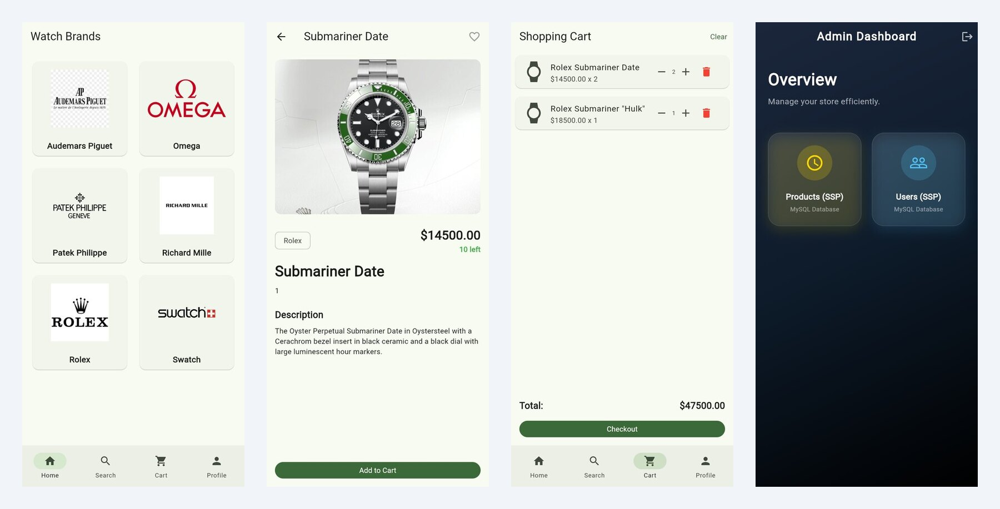</p>

<p align="center"><sub>Real screens from the running app, talking to the real Laravel-Watch API with its sample data.</sub></p>

## On this page

* [What you get](#what-you-get)
* [How everything fits together](#how-everything-fits-together)
* [Try it first](#try-it-first): run the app with no Firebase project
* [Run it with your own Firebase](#run-it-with-your-own-firebase)
* [A tour of the screens](#a-tour-of-the-screens)
* [Known issues](#known-issues)
* [Help and more reading](#help-and-more-reading)

## What you get

Three kinds of account use the same app. After sign-in the app opens the right screen for the role.

| | |
|---|---|
| **Customers** | A brand grid, a watch list for each brand, search, a detail page, favourites with an animated heart, a cart with quantities, and a profile with a photo, location and battery level |
| **Sellers** | A dashboard and an inventory list of their own watches |
| **Admins** | A dashboard with product and user management |
| **Sign in** | Email and password, or Google, through Firebase Auth |
| **Quick to open** | The last catalogue is kept on the device (Hive) and shown at once while the new one loads |
| **Looks** | A soft light theme by default, with a dark theme and a system option on the profile page |
| **Runs on** | Android, iOS and the web. The web build is in `build/web` |

## How everything fits together

The app does not have a database of its own. Firebase says who you are, and the Laravel API holds everything else.

<p align="center"><a href="docs/images/how-it-fits.svg"></a></p>

Signing in takes a few steps, and they decide which screen you see:

<p align="center"><a href="docs/images/sign-in-flow.svg">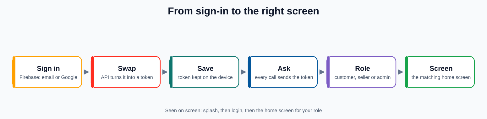</a></p>

The long version is in [How it works](docs/How%20it%20works.md).

## Try it first

You can run the whole app **without a Firebase project**. A second entry point, `lib/main_demo.dart`, signs in to a local Laravel-Watch with one of its sample accounts, so every screen runs against real data.

You need the [Flutter SDK](https://docs.flutter.dev/get-started/install), and [Laravel-Watch](https://github.com/Hikki-dev/Laravel-Watch) running on your computer (its README takes five minutes).

```bash
git clone https://github.com/Hikki-dev/Watch-final.git
cd Watch-final
cp .env.example .env
```

Open `.env` and change the `API_BASE_URL` line, so the app talks to your local backend. The Firebase lines can stay empty for the demo.

```env
API_BASE_URL=http://127.0.0.1:8000/api
```

Then start it, choosing which account to be:

```bash
flutter pub get
flutter run -d chrome -t lib/main_demo.dart --dart-define=DEMO_ROLE=customer
# or DEMO_ROLE=seller, or DEMO_ROLE=admin
```

On the web build you can also change the account in the address, for example `?role=admin`. More in [Demo mode](docs/Demo%20mode.md).

## Run it with your own Firebase

The real app needs a Firebase project with **Email/Password** and **Google** sign-in switched on, a `.env` with your keys, and a running Laravel-Watch API. The steps, with the table of every key, are in **[the setup guide](docs/SETUP.md)**.

```bash
flutter pub get
flutter run             # phone or emulator
flutter run -d chrome   # web
```

## A tour of the screens

The pictures are taken from the demo mode above with the customer, seller and admin accounts.

### Customers

<p align="center">
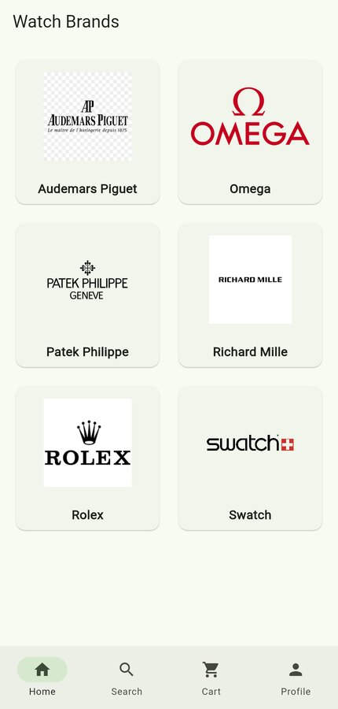
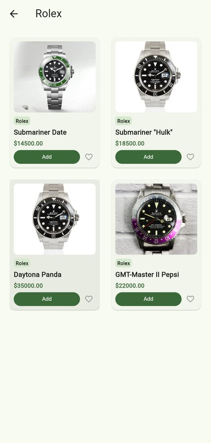
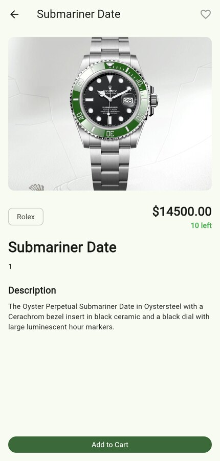
</p>

The home screen is a grid of brands. A brand shows its watches, each with a price, an **Add** button and a heart for favourites. The detail page has a big picture, the stock left and the description.

<p align="center">
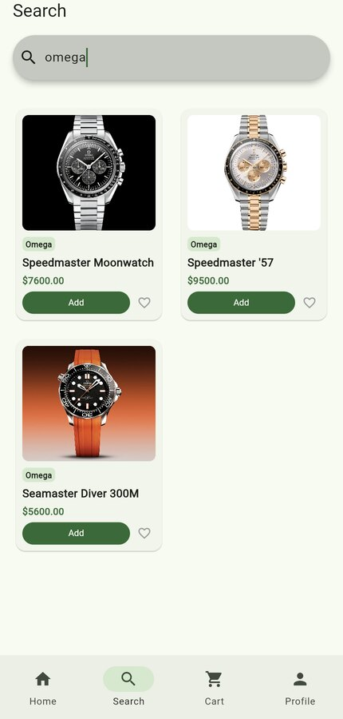
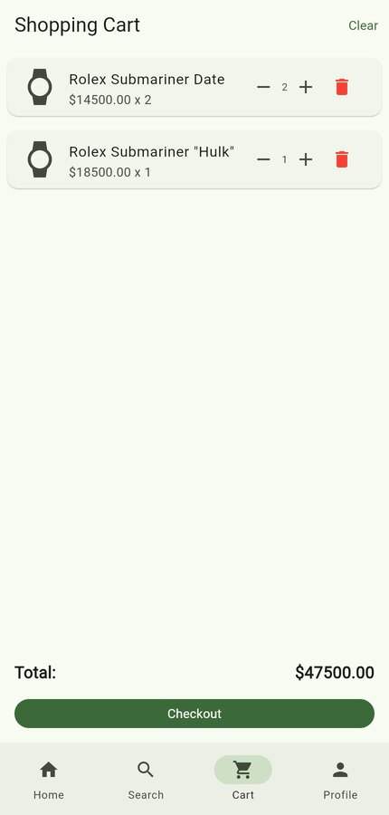
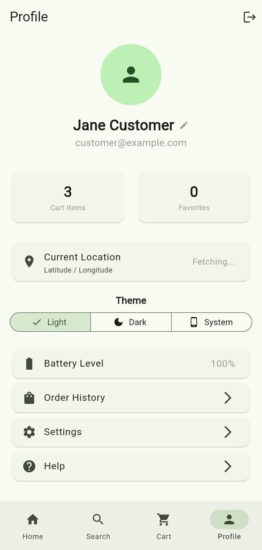
</p>

Search narrows the list as you type. The cart is stored on the server, so it follows you to another phone. The profile page shows your name and photo, your counts, where you are, the theme choice and the battery level of the device.

### Sellers and admins

<p align="center">
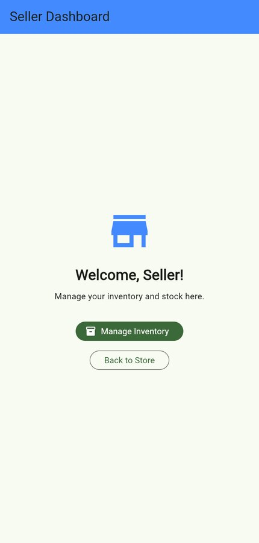
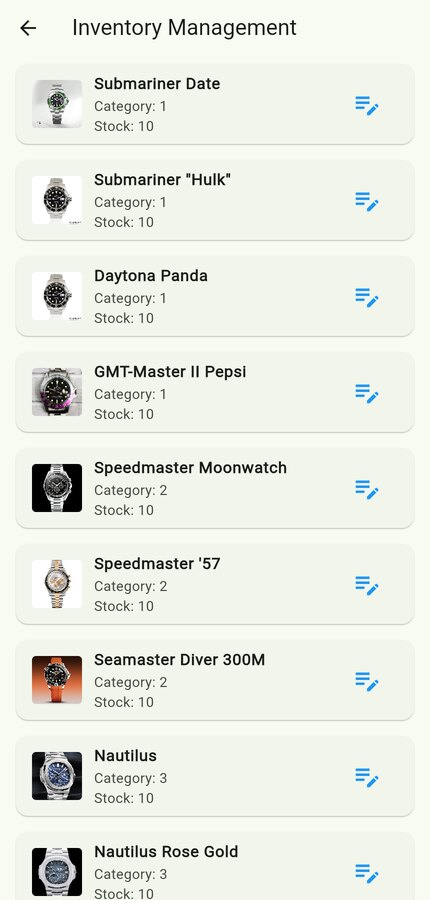
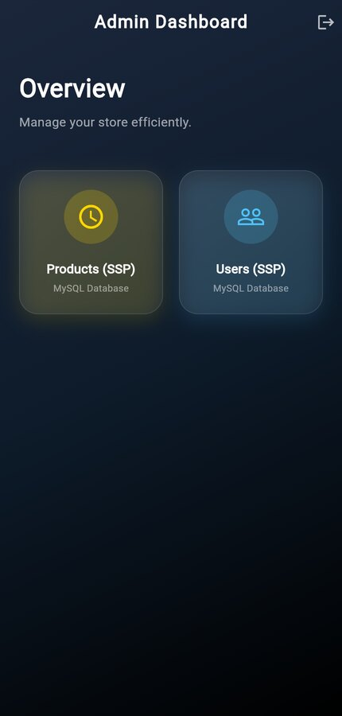
</p>

A seller opens their inventory and edits a watch. An admin has product and user management tiles. See the [known issues](#known-issues) for the state of these two tiles.

## Known issues

This is a coursework project that grew, and some parts are unfinished. Here is what is true today.

1. **Checkout is a placeholder.** The **Checkout** button on the cart shows an "Order Placed" message and clears the cart. No order is created and nothing is paid. Real checkout with Stripe exists on the Laravel-Watch website, not in the app.
2. **Order history and Settings** on the profile page show a "coming soon" message.
3. **The admin "Products" and "Users" tiles only work against the hosted backend, and "Users" does not work at all.** They use `ApiService`, which has the hosted address hard-coded (`https://laravel-watch-production.up.railway.app`), ignores `API_BASE_URL`, and sends no token. The products list is public, so it loads from the hosted API. The users route needs an admin token, so it answers with an error everywhere.
4. **No iOS location text yet.** `ios/Runner/Info.plist` needs `NSLocationWhenInUseUsageDescription` before the "current location" feature works on an iPhone.
5. **The catalogue is polled every 30 seconds**, not streamed.
6. **`build/web` is committed.** It can be deleted and rebuilt.
7. The tests under `test/` call the live backend, so they need a network and the hosted API to be up.

## Help and more reading

| If you want to | Read |
|---|---|
| Run it with no Firebase project | [Demo mode](docs/Demo%20mode.md) |
| Set up Firebase, the keys and a backend | [Setup guide](docs/SETUP.md) |
| Understand how it is built | [How it works](docs/How%20it%20works.md) |
| Fix a problem | [Fixing problems](docs/Fixing%20problems.md) |
| Find a quick answer | [Questions and answers](docs/FAQ.md) |
| Run or change the backend | [Laravel-Watch](https://github.com/Hikki-dev/Laravel-Watch) |
| Change the code | [Contributing](CONTRIBUTING.md) |
| Report a security problem | [SECURITY.md](SECURITY.md) |
| See what changed | [Changes](CHANGELOG.md) |

## Contributing

Fixes and ideas are welcome. Read [CONTRIBUTING.md](CONTRIBUTING.md) first.

## Credits

Built with [Flutter](https://flutter.dev), [Firebase](https://firebase.google.com) and [Hive](https://pub.dev/packages/hive). The watch photographs and brand logos belong to their owners and are used here as sample content only.

## Licence

No licence file yet, so for now all rights are reserved by the author.

Built by [Yusuf (Hikki-dev)](https://github.com/Hikki-dev).
