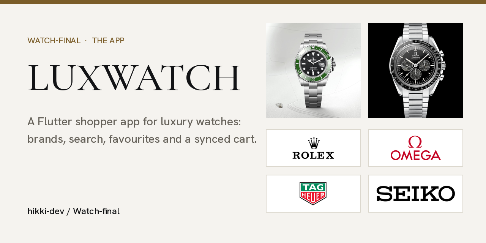
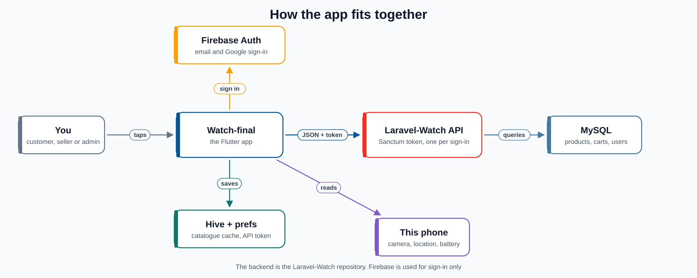
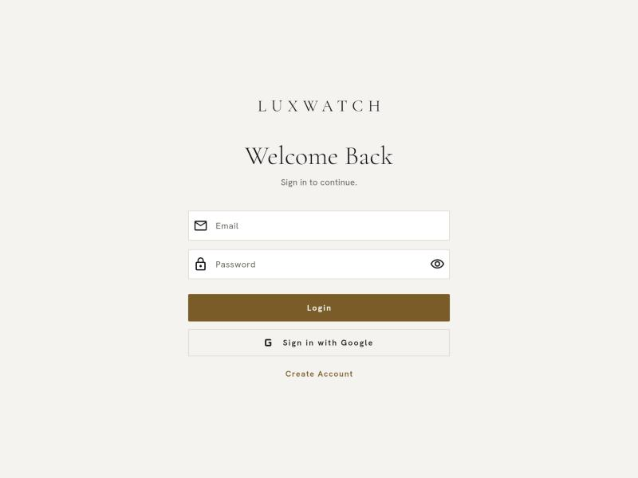
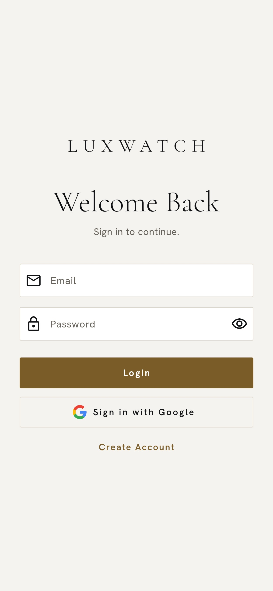
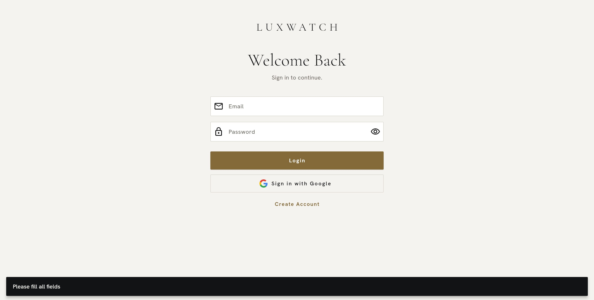
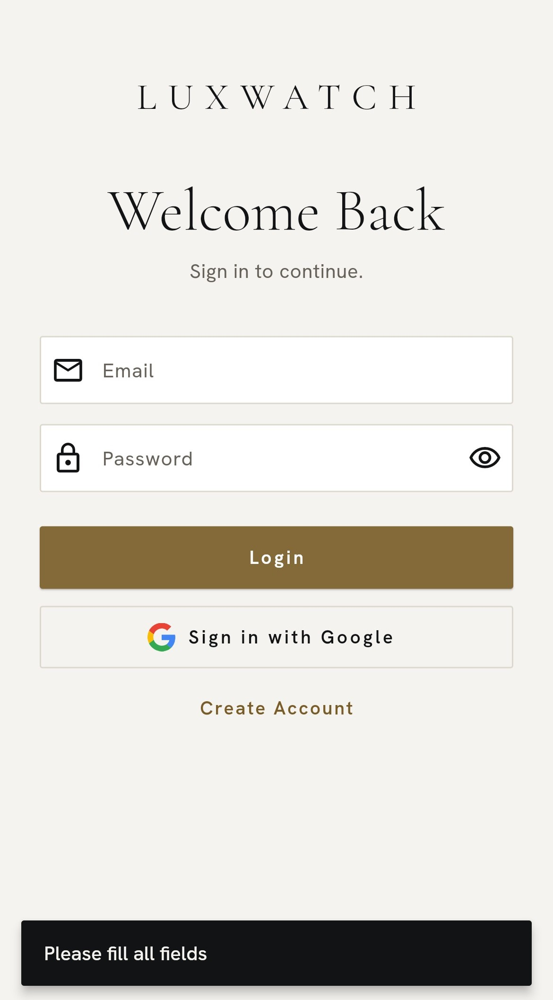
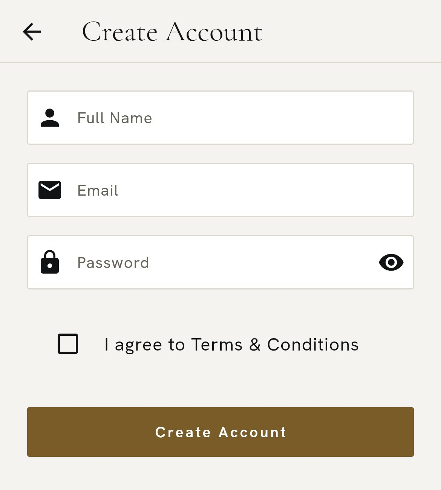
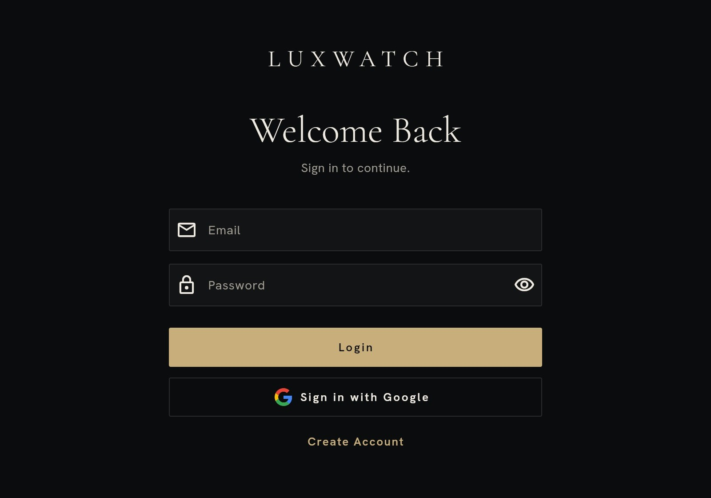

# LUXWATCH: the shopper app

[](https://flutter.dev)
[](https://dart.dev)
[](https://firebase.google.com)
[](https://github.com/Hikki-dev/Laravel-Watch)

[](https://hikki-dev.github.io/Watch-final/)
[](LICENSE)

A luxury watch store you carry in your pocket. Shoppers browse by brand, search, open a watch, save favourites and keep a cart that follows them from device to device. Sellers manage their stock and admins manage products and people, all from the same app.

<p align="center"></p>

It is a portfolio project, built to show a careful Flutter app that talks to a real backend. You do not need to know Flutter to follow this page. Everything is explained in plain words, one step at a time.

**This is one half of a pair.** Watch-final is the **shopper app**. [Laravel-Watch](https://github.com/Hikki-dev/Laravel-Watch) is the **marketplace** behind it: the website, the database and the REST API. The app owns no watch data of its own. It signs people in, then asks the marketplace for everything else.

## On this page

* [What you get](#what-you-get): the parts of the app
* [Two repos, one store](#two-repos-one-store): the app and the marketplace
* [How everything fits together](#how-everything-fits-together): from a tap to the database
* [The live demo](#the-live-demo): the web version on GitHub Pages
* [Before you start](#before-you-start): what your computer needs
* [Run it yourself](#run-it-yourself): ten minutes to a running app
* [A tour of the app](#a-tour-of-the-app)
  * [1. Opening the app](#1-opening-the-app)
  * [2. Signing in](#2-signing-in)
  * [3. The home screen](#3-the-home-screen)
  * [4. A brand and search](#4-a-brand-and-search)
  * [5. A watch up close](#5-a-watch-up-close)
  * [6. Favourites and the cart](#6-favourites-and-the-cart)
  * [7. Your profile](#7-your-profile)
  * [8. The seller area](#8-the-seller-area)
  * [9. The admin area](#9-the-admin-area)
* [Under the hood](#under-the-hood)
* [Your privacy and safety](#your-privacy-and-safety)
* [Help and more reading](#help-and-more-reading)
* [Legal and the pictures](#legal-and-the-pictures)

## What you get

Each part does one small job. Together they make a store that works even on a bad connection.

| | What | What it does |
|---|---|---|
| 🛍️ | **Browse by brand** | Ten brand logos, and a page of watches for each |
| 🔎 | **Search** | Find a watch by typing part of its name |
| ❤️ | **Favourites** | An animated heart, saved to your account on the server |
| 🛒 | **Cart** | Quantities, saved to your account on the server |
| 🔄 | **360° view** | Drag a watch round, when the marketplace has frames for it |
| 👤 | **Three roles** | Customers shop, sellers manage stock, admins manage products and users |
| 🔐 | **Sign in** | Email and password, or Google, through Firebase |
| 📴 | **Starts fast** | The last catalogue is kept on the device with Hive and shown while fresh data loads |
| 🌗 | **Light and dark** | Light by default, with a switch that is remembered |

## Two repos, one store

| | Watch-final (this repo) | [Laravel-Watch](https://github.com/Hikki-dev/Laravel-Watch) |
|---|---|---|
| **Role** | The shopper app | The marketplace: website, database, API |
| **Built with** | Flutter, Firebase sign in, Hive | Laravel 12, Livewire, Postgres or MySQL |
| **Holds the data?** | No. It keeps a copy of the catalogue to start fast | Yes. Watches, orders and accounts live there |
| **Live demo** | <https://hikki-dev.github.io/Watch-final/> | <https://luxwatch-livid.vercel.app> |

The two share one look: the same colours, the same three fonts and the same way of showing a watch on a soft backdrop. Roles are the same in both, and the marketplace is the one that enforces them.

## How everything fits together

A person opens the app and signs in with Firebase. The app hands the Firebase proof to the marketplace, which answers with its own token. From then on, every request carries that token. The app keeps the last catalogue on the device, so the home screen is never empty while it waits.

<p align="center"><a href="docs/images/how-it-fits.svg"></a></p>

The longer story, step by step, is in [How everything fits](docs/How%20everything%20fits.md).

## The live demo

**[Open the web version](https://hikki-dev.github.io/Watch-final/).** It is the same Flutter app, built on GitHub and served by GitHub Pages. It opens on a short splash and then the sign in screen, with an email, a password, **Login**, **Sign in with Google** and **Create Account**. It talks to the [Laravel-Watch](https://github.com/Hikki-dev/Laravel-Watch) demo for its data. Nothing is sold, and no real money moves.

The older address <https://watchapp-phi.vercel.app> is gone (it answers "deployment not found"). Pages replaces it.

You can also see the marketplace the app talks to. **[Open the Laravel-Watch demo](https://luxwatch-livid.vercel.app)** and you will recognise the same watches, brands and colours.

[Deploying the web version](docs/DEPLOYMENT.md) lists the steps to build it yourself.

## Before you start

You need three things:

1. The [Flutter SDK](https://docs.flutter.dev/get-started/install) (Dart `^3.8.1`).
2. A free [Firebase](https://console.firebase.google.com/) project with Email/Password and Google sign in switched on.
3. A running copy of the [Laravel-Watch](https://github.com/Hikki-dev/Laravel-Watch) API, yours or a hosted one.

## Run it yourself

```bash
git clone https://github.com/Hikki-dev/Watch-final.git
cd Watch-final
flutter pub get
```

Make a file called `.env` in the folder. **The app will not build or start without it.** At minimum it needs the API address and your Firebase values:

```env
API_BASE_URL=https://your-host/api
FIREBASE_PROJECT_ID=your-project-id
FIREBASE_MESSAGING_SENDER_ID=...
FIREBASE_STORAGE_BUCKET=your-project-id.appspot.com
FIREBASE_WEB_API_KEY=...
FIREBASE_WEB_APP_ID=...
FIREBASE_WEB_AUTH_DOMAIN=your-project-id.firebaseapp.com
```

For the Laravel-Watch demo on Vercel the address is `https://luxwatch-livid.vercel.app/api/api`, because Vercel uses `/api` for its own functions.

Then run it:

```bash
flutter run             # a phone or an emulator
flutter run -d chrome   # the web version
```

Every key, and what to do for Android and iOS, is in [Getting started](docs/Getting%20started.md). If something does not work, try [Fixing problems](docs/Fixing%20problems.md).

## A tour of the app

This tour follows a shopper from the first launch to the admin tools. It is written from the code of each screen, so every name and button below exists in the app. **Step 2 has pictures** of the web version (sign in, an empty form, creating an account and the dark theme), taken at high sharpness from the live site. The screens after sign in need an account, so they are described but not pictured. The look is also shown in the picture at the top and in the [Design](docs/DESIGN.md) guide, and the matching website screens are in the [Laravel-Watch walkthrough](https://github.com/Hikki-dev/Laravel-Watch#the-store-step-by-step).

### 1. Opening the app

A short splash screen shows while the app starts, checks who is signed in and loads the saved theme. If the app cannot start (a missing `.env`, for instance), it shows a plain "Initialization Error" screen with the reason instead of a blank page.

### 2. Signing in

The sign in screen has an email and a password, a **Login** button and a **Sign in with Google** button. A new person taps **Create Account**, fills in the form and ticks **I agree to Terms & Conditions**. Firebase checks the person. The app then trades Firebase's proof for a token from the marketplace and keeps it on the device.

<p align="center"> </p>

These are the web version, on a desktop and at phone width. The screens after sign in need an account, so they are described but not pictured.

#### If a box is empty

Press **Login** with nothing typed and the app answers with a short message at the bottom of the screen: "Please fill all fields". Nothing is sent to the server.

<p align="center"> </p>

#### Creating an account

**Create Account** opens a short form: **Full Name**, **Email**, **Password**, and the box **I agree to Terms & Conditions**. The back arrow returns to sign in. Without the tick the app says "Please agree to terms".

<p align="center"></p>

#### The dark theme

The app is light by default. The dark theme uses the same layout with a dark ground and a gold button, and the choice is remembered on the device.

<p align="center"></p>

**Known problem:** Google sign in has not been tested end to end for this write up. The live Laravel demo now has the Firebase key it needs to check the token, but a real Google sign in from the app was not tried. Email and password sign in is the other route. See [Fixing problems](docs/Fixing%20problems.md).

After sign in, the app opens the screen that matches the person's role: shoppers go home, sellers and admins reach their own dashboards from the profile.

### 3. The home screen

The home screen is called **Discover**. It shows a **Shop by brand** grid of logos on white plates, so every logo looks right in both themes. The top bar has **Search**, **Cart** and **Account**, and a button that switches between light and dark. If the catalogue has no brands yet, the app says "No brands available".

### 4. A brand and search

Tapping a logo opens the brand page with that maker's watches. **Search** opens a page with a "Search watches..." box that filters the catalogue as you type.

### 5. A watch up close

The watch page shows the photo, the brand, the price in the shop's price style and a **Description**. If the marketplace has at least eight 360° frames for the watch, the photo becomes a viewer you can drag, with momentum and quick buttons for Front, Angle, Side and Back. Otherwise it shows the plain photo. Adding to the cart shows "Added to cart". The heart saves the watch to your favourites with a small animation.

### 6. Favourites and the cart

**My Favorites** lists the hearts you have saved. They live on the server, so they follow you to another device.

**Your cart** lists each watch with a quantity you can change, and two buttons, **CHECKOUT** and **CLEAR**. An empty cart says "Your cart is empty". **CHECKOUT is a placeholder**: it shows "Order Placed, Thank you for your purchase!" and empties the cart. It takes no payment and creates no order. The real checkout, with Stripe, lives on the marketplace website.

### 7. Your profile

The profile screen lets you change your name (**Edit Name**), and your picture from the **Camera** or the **Photo Gallery**. It also shows your **Current Location** and **Battery Level**, offers a **Light**, **Dark** or **System** theme, and has **Help & Support**. **Order History** and **Settings** say "coming soon". Sellers and admins also see a shortcut to their dashboard here.

### 8. The seller area

The **Seller Dashboard** welcomes the seller and offers **Manage inventory**. The inventory list shows each product, with **Edit stock** to set a new quantity, and marks anything with none left as **Sold out**. **Back to store** returns to the shop.

### 9. The admin area

The **Admin Dashboard** has an **Overview** and two areas, **Products** and **Users**. Admins add, edit and remove products, and see every user with their role. An admin can change a person's role to customer, seller or admin, or delete the account.

## Under the hood

| Area | Choice |
|---|---|
| Framework | Flutter, Dart `^3.8.1` |
| State | `provider`, with one `AppController` |
| Sign in | `firebase_auth`, `google_sign_in` |
| Talking to the store | `http` against the Laravel-Watch REST API |
| On the device | `hive`, `hive_flutter`, `shared_preferences` |
| Pictures | `cached_network_image`, `image_picker` |
| Device | `geolocator`, `battery_plus`, `connectivity_plus` |
| Settings | `flutter_dotenv` |
| Tests | 15 tests in `test/`. The API ones call a live backend |

The catalogue is refreshed from the API every 30 seconds while a screen is listening. The design is light by default with a dark switch, and three fonts bundled in the app (Cormorant Garamond, Hanken Grotesk and DM Mono). Read [Design](docs/DESIGN.md) for the parts and [How it works](docs/How%20it%20works.md) for a map of the code.

## Your privacy and safety

* Passwords are handled by Firebase. The app never stores one.
* The app keeps an API token on the device, and removes it when you sign out.
* The profile screen asks for the camera, the photo gallery and your location, and only when you use those features.
* The app does not take payments. Cards are entered on Stripe, on the marketplace website.
* `.env` is never committed. The Firebase client files that are committed (`google-services.json` and the iOS and macOS plists) hold client identifiers, not server secrets. Restrict them in the Firebase console.
* **Before shipping to iPhone**, add `NSLocationWhenInUseUsageDescription` to `ios/Runner/Info.plist`. It is not there yet, and the location feature needs it.

To report a security problem, read [SECURITY.md](SECURITY.md).

## Help and more reading

| If you want to | Read |
|---|---|
| Run the app | [Getting started](docs/Getting%20started.md) |
| See how the app and the store fit | [How everything fits](docs/How%20everything%20fits.md) |
| Understand the code | [How it works](docs/How%20it%20works.md) |
| Change colours, fonts or the 360 view | [Design](docs/DESIGN.md) |
| Put the web version online | [Deployment](docs/DEPLOYMENT.md) |
| Fix a problem | [Fixing problems](docs/Fixing%20problems.md) |
| Find a quick answer | [Questions and answers](docs/FAQ.md) |
| See what changed | [Changes](CHANGELOG.md) |
| Help build it | [Contributing](CONTRIBUTING.md) |

## Legal and the pictures

* This is a demonstration. It sells nothing, and any brand names are used only to describe the watches.
* **Brand logos and watch photos.** The files in `assets/images/` are third party pictures kept for a private showcase. Do not reuse them elsewhere, and replace them with your own before showing the app to the public.
* The code is under the [MIT licence](LICENSE). That covers the code only, not the pictures above.
* It is provided as it is, with no promises.

## Credits

Built by [Yusuf (Hikki-dev)](https://github.com/Hikki-dev). Flutter, Firebase and Hive do the heavy lifting. Fonts are Cormorant Garamond, Hanken Grotesk and DM Mono.
